# NoxCut · presentación del proyecto

**Ver la presentación y los vídeos:** https://garzanox.github.io/noxcut/

NoxCut es un editor de vídeo para creadores, en horizontal o en vertical, con subtítulos palabra a palabra y
ayudas para sacar shorts (TikTok, Reels, Shorts) de los directos de videojuegos. Funciona entero en el ordenador, sin nube ni suscripciones.

Este repositorio solo contiene la presentación: una página web con las diapositivas en imágenes y vídeos
cortos de NoxCut funcionando (carpeta `videos/`). No hay
programas que descargar ni ejecutar. Se actualiza a medida que avanza el proyecto.

## Vídeos: míralo funcionando

GitHub no reproduce los vídeos dentro del repositorio: pulsa una imagen para verlo en la página.

### [Editar con la voz](https://garzanox.github.io/noxcut/#video-voz) (0:26)

[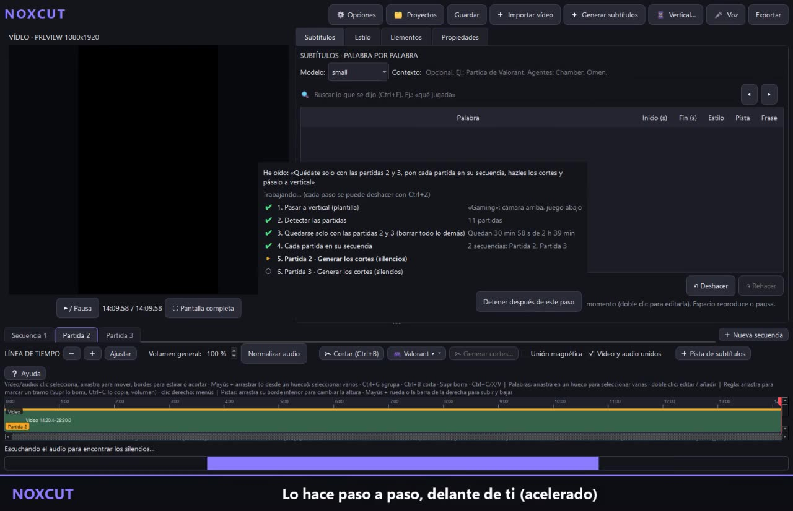](https://garzanox.github.io/noxcut/#video-voz)

Se lo dices como a una persona: NoxCut enseña lo que ha entendido, paso a paso, y lo hace delante de ti.

### [Subtítulos palabra a palabra](https://garzanox.github.io/noxcut/#video-subtitulos) (0:30)

[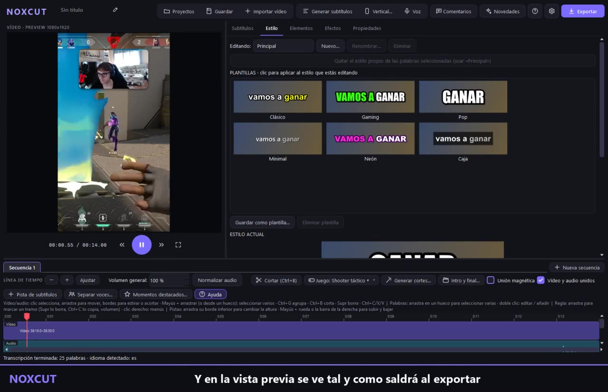](https://garzanox.github.io/noxcut/#video-subtitulos)

Se generan en tu ordenador (sin internet), cada palabra con su tiempo. Se corrigen escribiendo y el estilo se elige de una galería: karaoke, palabra a palabra o con «pop».

### [Plantilla vertical con la cámara flotante](https://garzanox.github.io/noxcut/#video-camara) (0:26)

[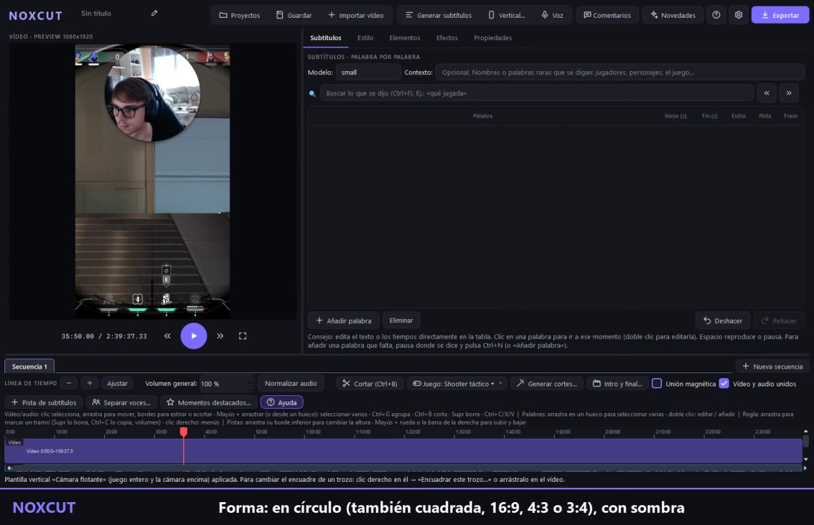](https://garzanox.github.io/noxcut/#video-camara)

El juego a pantalla completa y tu cámara encima, en círculo (o cuadrada, 4:3, 3:4…), con sombra. Se arrastra a cualquier sitio en la vista previa y la rueda del ratón cambia su tamaño.

### [Detectar partidas y una secuencia por partida](https://garzanox.github.io/noxcut/#video-partidas) (0:22)

[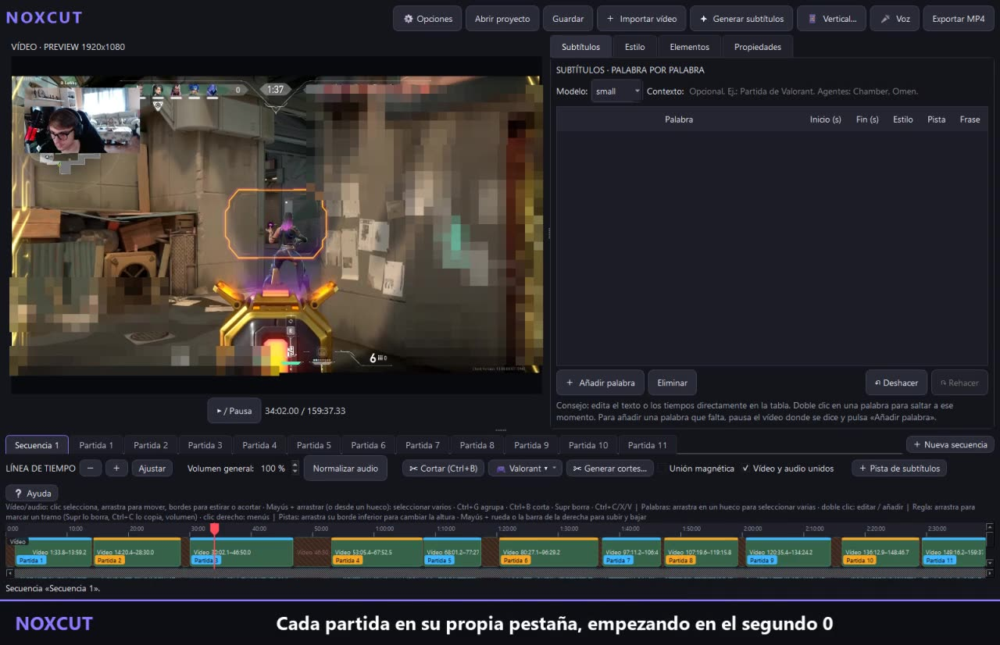](https://garzanox.github.io/noxcut/#video-partidas)

Un directo de 2 h 40 min: NoxCut encuentra las 11 partidas y pasa cada una a su propia pestaña.

### [Recopilar tus kills](https://garzanox.github.io/noxcut/#video-kills) (0:37)

[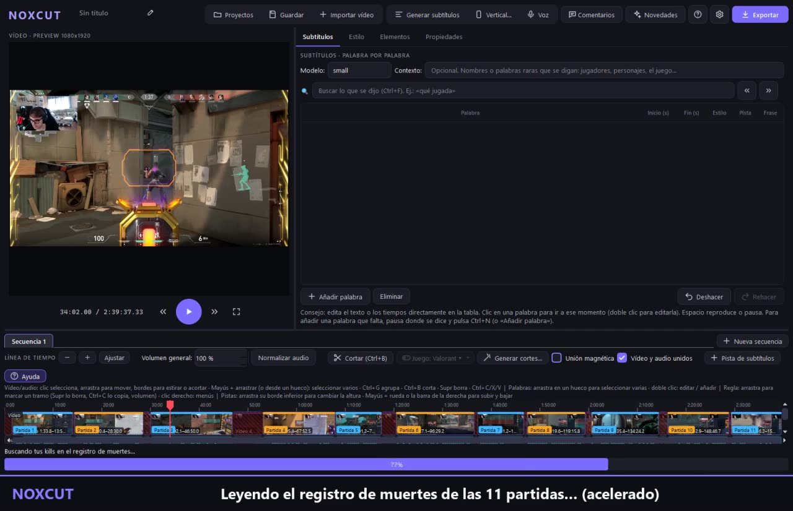](https://garzanox.github.io/noxcut/#video-kills)

Sin escribir nada: NoxCut reconoce al jugador por sus propias muertes, cuenta las kills de cada ronda y se queda con las que elijas (dobles, triples, ace…). Antes de cambiar nada, dice lo que va a hacer.

### [Tus proyectos al abrir](https://garzanox.github.io/noxcut/#video-proyectos) (0:23)

[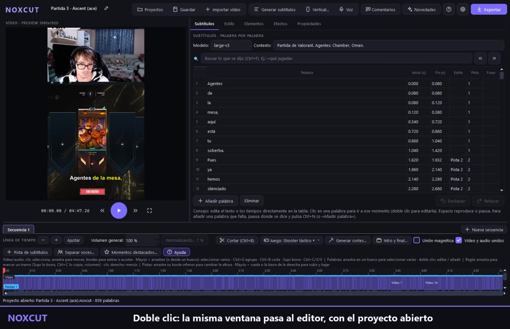](https://garzanox.github.io/noxcut/#video-proyectos)

Una sola ventana: NoxCut se abre con todos tus proyectos, cada uno con un fotograma de su vídeo. Se buscan mientras escribes y, al elegir uno, la misma ventana pasa al editor.

### [Elementos: arrastrar y buscar](https://garzanox.github.io/noxcut/#video-elementos) (0:17)

[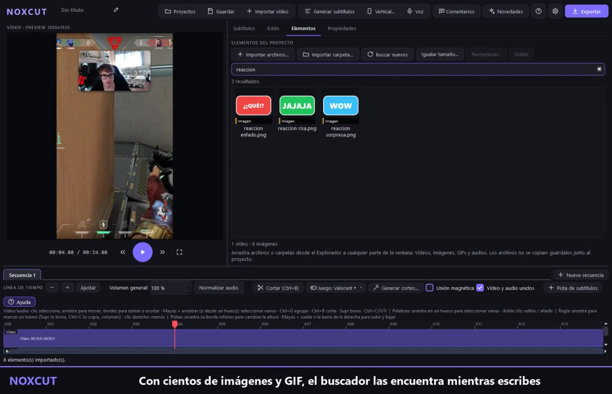](https://garzanox.github.io/noxcut/#video-elementos)

Imágenes y GIF arrastrados desde el Explorador o el Finder a cualquier parte de la ventana. Con cientos, el buscador los encuentra mientras escribes; luego, al vídeo.

### [La guía: cada parte, explicada en su sitio](https://garzanox.github.io/noxcut/#video-guia) (0:27)

[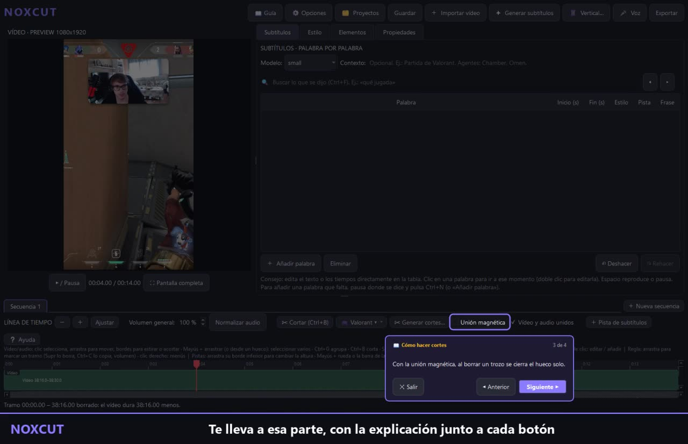](https://garzanox.github.io/noxcut/#video-guia)

«📖 Guía»: elige un tema (por ejemplo, «Cómo hacer cortes») y NoxCut te lleva a esa parte, con una explicación junto a cada botón. O el recorrido completo, que se para y se sigue cuando quieras.

### [Seleccionar, borrar y agrupar trozos](https://garzanox.github.io/noxcut/#video-seleccion) (0:25)

[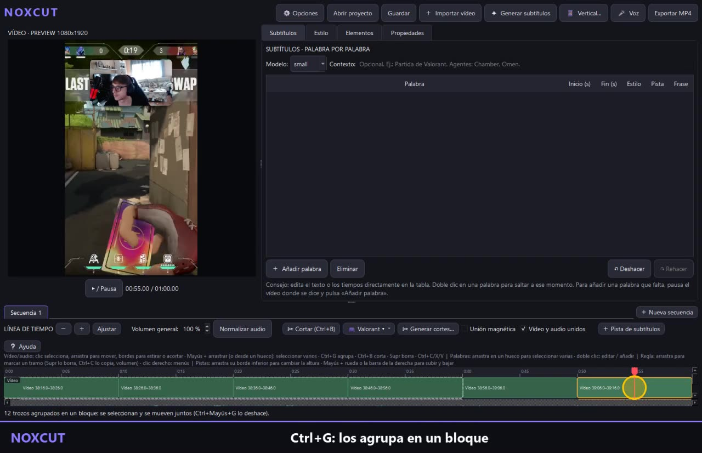](https://garzanox.github.io/noxcut/#video-seleccion)

Como en cualquier editor: arrastrar para seleccionar varios trozos, Mayús + clic, borrar un tramo de todas las pistas desde la regla y agrupar trozos en un bloque que se mueve entero.

---

# NoxCut · project presentation (English)

**See the presentation and the videos:** https://garzanox.github.io/noxcut/en/

NoxCut is a video editor for creators, horizontal or vertical, with word-by-word subtitles and helpers to get
shorts (TikTok, Reels, Shorts) out of gaming streams. It runs entirely on your computer, with no cloud and no
subscriptions.

This repository only contains the presentation: a web page with the slides as images and short videos of NoxCut
in action. There are no programs to download or run. It's updated as the project moves forward.

## Videos: see it in action

GitHub doesn't play videos inside the repository: click an image to watch it on the page.

### [Editing by voice](https://garzanox.github.io/noxcut/en/#video-voz) (0:26)

[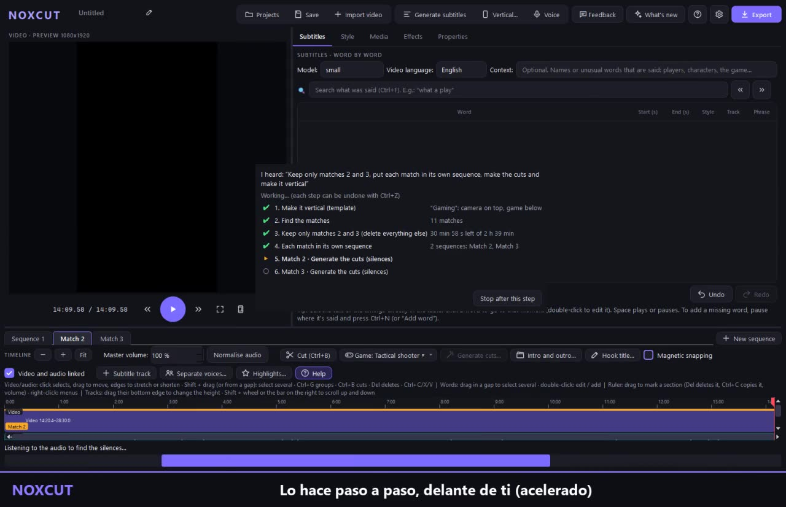](https://garzanox.github.io/noxcut/en/#video-voz)

You tell it like you'd tell a person: NoxCut shows what it understood, step by step, and does it in front of you.

### [Word-by-word subtitles](https://garzanox.github.io/noxcut/en/#video-subtitulos) (0:30)

[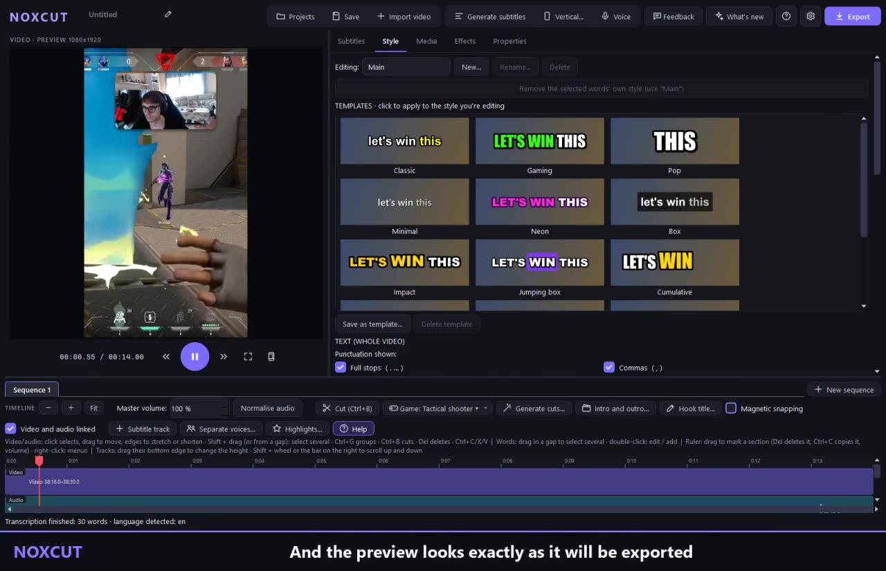](https://garzanox.github.io/noxcut/en/#video-subtitulos)

Generated on your computer (offline), each word with its timing. Corrected by typing, and the style is chosen from a gallery: karaoke, word by word or with “pop”.

### [Vertical template with the floating camera](https://garzanox.github.io/noxcut/en/#video-camara) (0:26)

[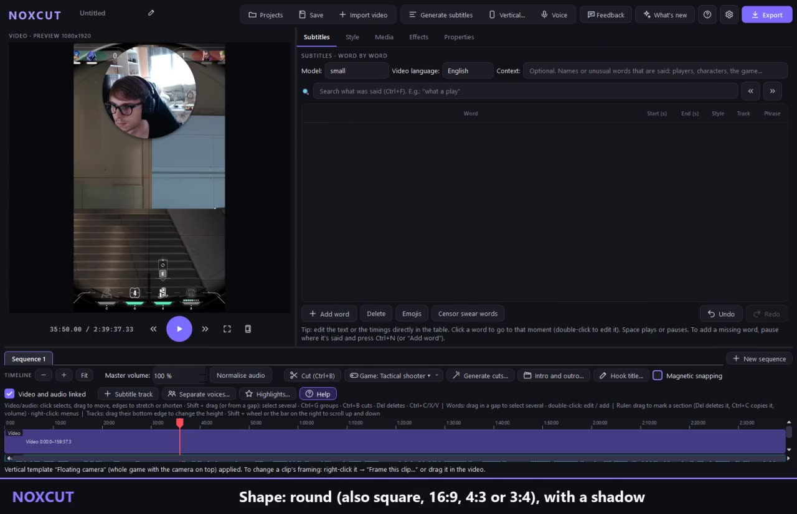](https://garzanox.github.io/noxcut/en/#video-camara)

The game full screen and your camera on top, round (or square, 4:3, 3:4…), with a shadow. Drag it anywhere in the preview and the mouse wheel changes its size.

### [Finding matches and one sequence per match](https://garzanox.github.io/noxcut/en/#video-partidas) (0:24)

[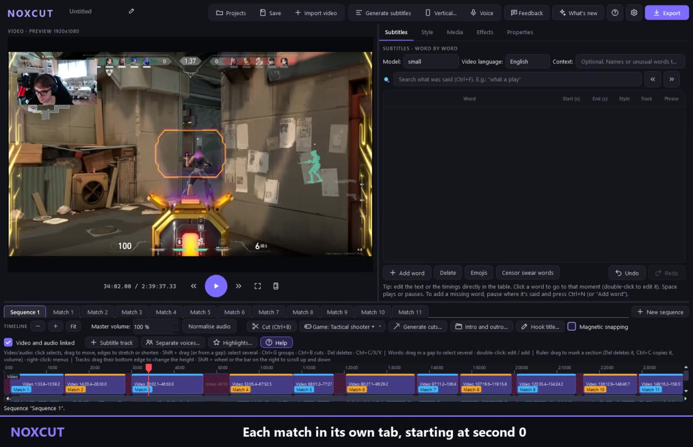](https://garzanox.github.io/noxcut/en/#video-partidas)

A 2 h 40 min stream: NoxCut finds the 11 matches and puts each one in its own tab.

### [Collecting your kills](https://garzanox.github.io/noxcut/en/#video-kills) (0:41)

[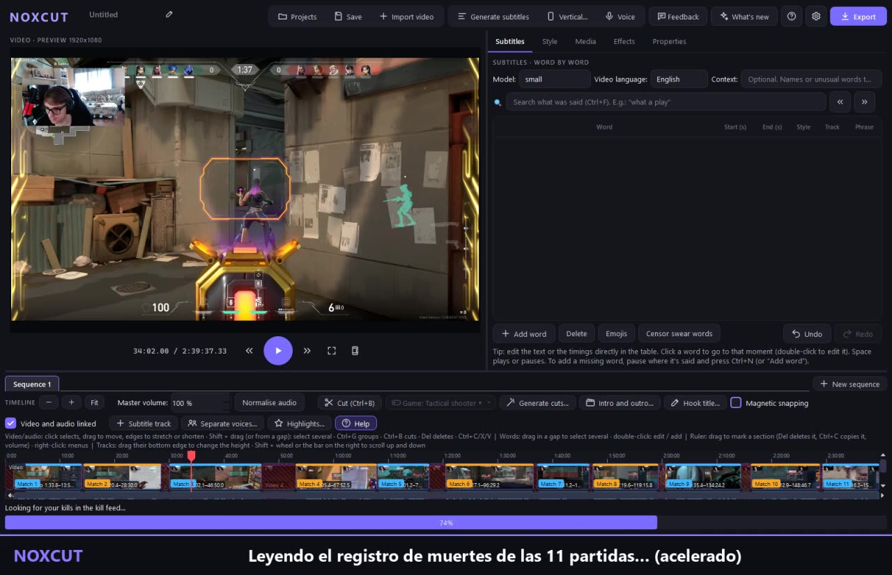](https://garzanox.github.io/noxcut/en/#video-kills)

Without typing anything: NoxCut recognises the player from their own deaths, counts the kills in each round and keeps the ones you choose (doubles, triples, aces…). Before changing anything, it says what it's going to do.

### [Your projects when it opens](https://garzanox.github.io/noxcut/en/#video-proyectos) (0:23)

[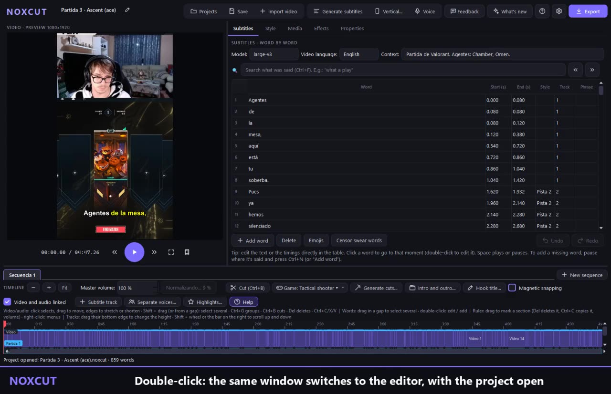](https://garzanox.github.io/noxcut/en/#video-proyectos)

A single window: NoxCut opens with all your projects, each with a frame from its video. Search as you type and, when you choose one, the same window switches to the editor.

### [Media: drag and search](https://garzanox.github.io/noxcut/en/#video-elementos) (0:17)

[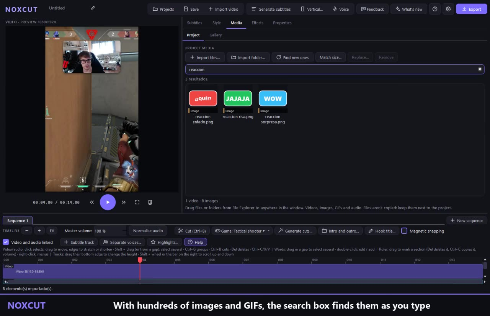](https://garzanox.github.io/noxcut/en/#video-elementos)

Images and GIFs dragged from File Explorer or the Finder to anywhere in the window. With hundreds, the search box finds them as you type; then, into the video.

### [The guide: every part, explained in place](https://garzanox.github.io/noxcut/en/#video-guia) (0:26)

[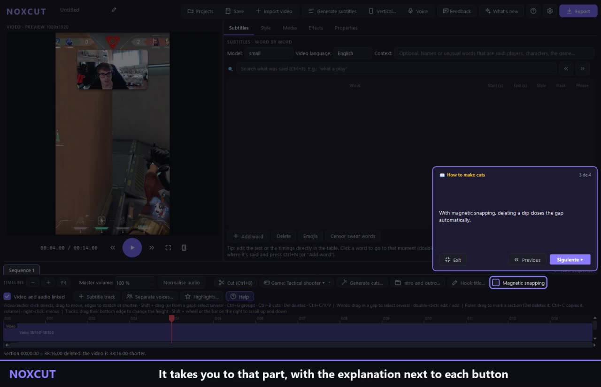](https://garzanox.github.io/noxcut/en/#video-guia)

“📖 Guide”: choose a topic (for example, “How to make cuts”) and NoxCut takes you to that part, with an explanation next to each button. Or the full tour, which you can stop and continue whenever you like.

### [Selecting, deleting and grouping clips](https://garzanox.github.io/noxcut/en/#video-seleccion) (0:25)

[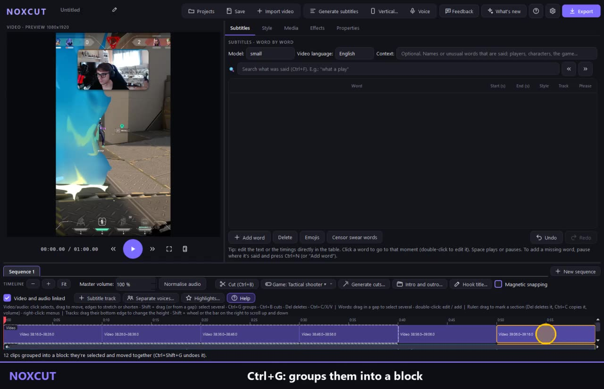](https://garzanox.github.io/noxcut/en/#video-seleccion)

Like in any editor: drag to select several clips, Shift + click, delete a section from every track using the ruler and group clips into a block that moves as one.
