# Vídeos de NoxCut

GitHub no reproduce los vídeos aquí: pulsa una imagen para verlo en la página.
### [Editar con la voz](https://noxcut.es/#video-voz) (0:26)

[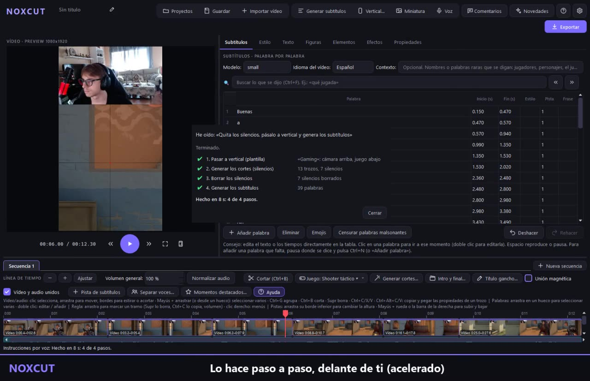](https://noxcut.es/#video-voz)

Se lo dices como a una persona: NoxCut enseña lo que ha entendido, paso a paso, y lo hace delante de ti.

### [Del guion al vídeo](https://noxcut.es/#video-guion) (0:31)

[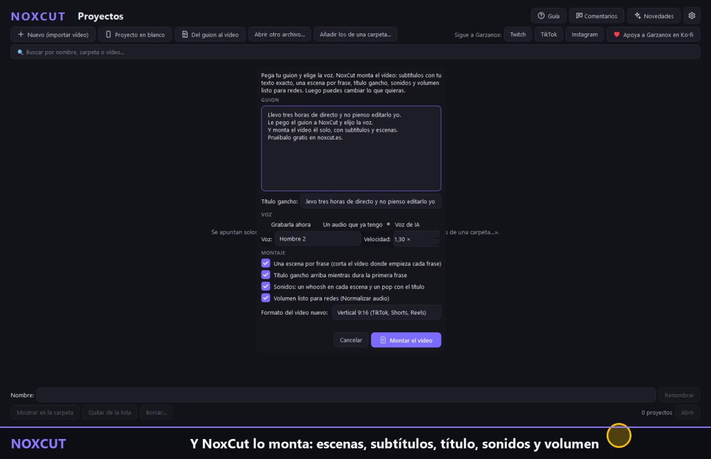](https://noxcut.es/#video-guion)

Pegas tu guion y eliges la voz (la grabas tú leyéndolo, un audio que ya tienes o una voz de IA): NoxCut monta el vídeo solo, con los subtítulos de tu texto, una escena por frase, el título gancho y los sonidos.

### [Publicar en TikTok, Instagram y YouTube (pronto)](https://noxcut.es/#video-publicar) (0:30)

[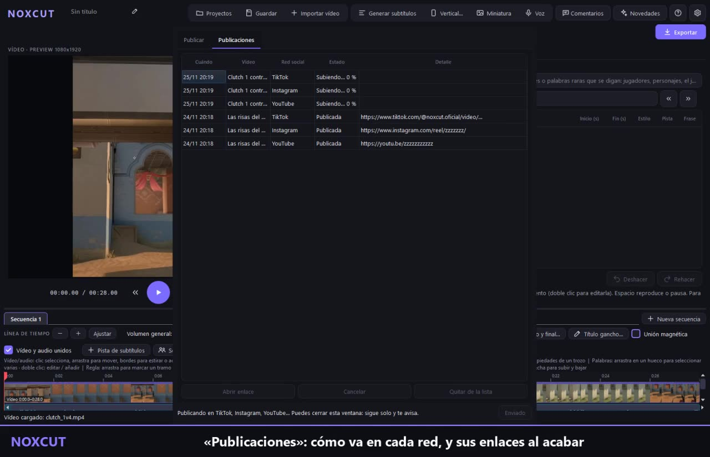](https://noxcut.es/#video-publicar)

Bloqueado hasta que TikTok, Instagram y YouTube aprueben la app de NoxCut. Las tres redes a la vez, con el texto de cada una ya escrito, tu portada, ahora o a una hora, y «Publicaciones» para ver cómo va.

### [Voz en off con IA](https://noxcut.es/#video-voz_ia) (0:28)

[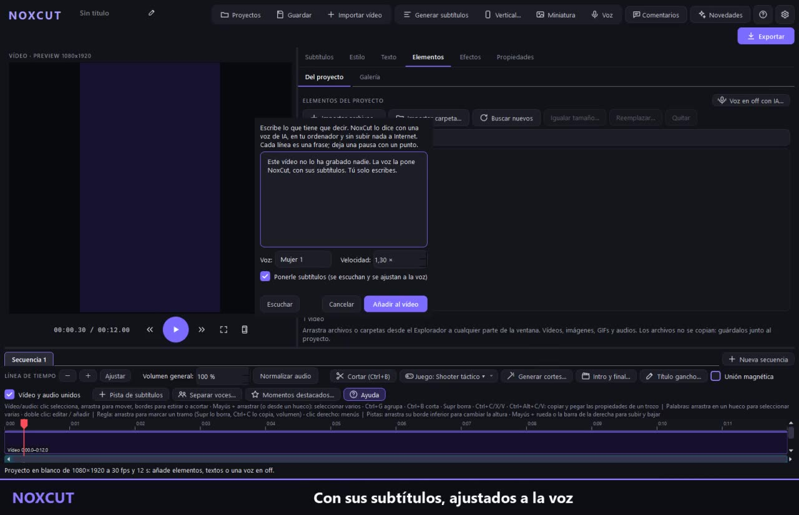](https://noxcut.es/#video-voz_ia)

Un proyecto en blanco para TikTok: escribes el texto, eliges una de las 10 voces (5 de hombre y 5 de mujer) y NoxCut la pone en una pista nueva, con sus subtítulos palabra a palabra. Todo en tu ordenador.

### [Subtítulos palabra a palabra](https://noxcut.es/#video-subtitulos) (0:30)

[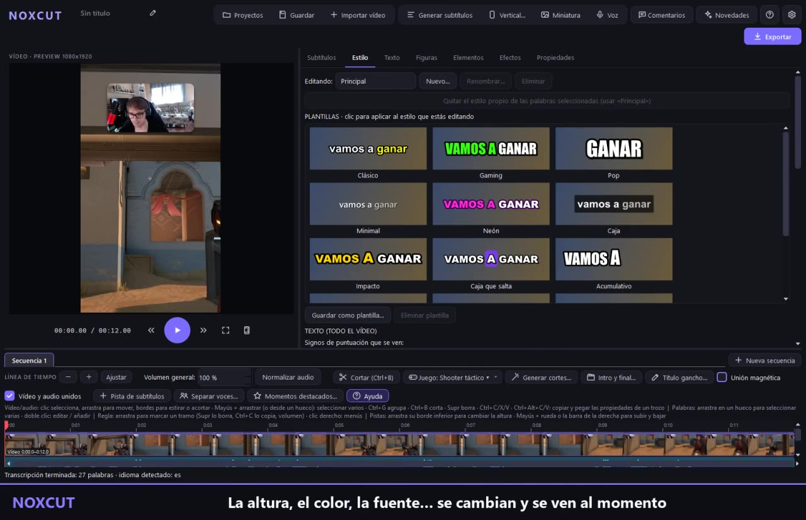](https://noxcut.es/#video-subtitulos)

Se generan en tu ordenador (sin internet), cada palabra con su tiempo. Se corrigen escribiendo y el estilo se elige de una galería: karaoke, palabra a palabra o con «pop».

### [Plantilla vertical con la cámara flotante](https://noxcut.es/#video-camara) (0:26)

[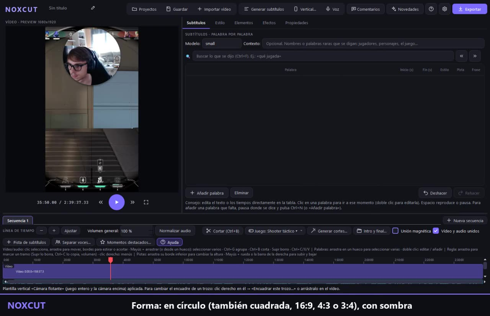](https://noxcut.es/#video-camara)

El juego a pantalla completa y tu cámara encima, en círculo (o cuadrada, 4:3, 3:4…), con sombra. Se arrastra a cualquier sitio en la vista previa y la rueda del ratón cambia su tamaño.

### [Detectar partidas y una secuencia por partida](https://noxcut.es/#video-partidas) (0:22)

[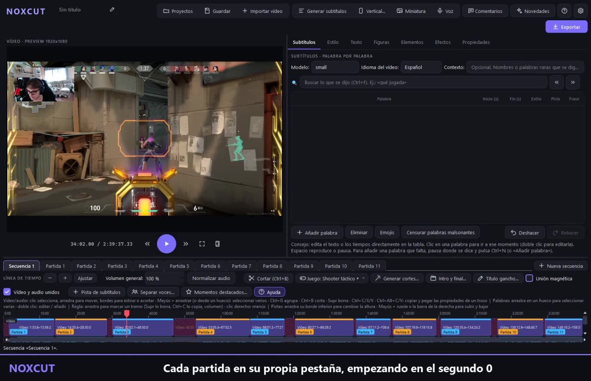](https://noxcut.es/#video-partidas)

Un directo de 2 h 40 min: NoxCut encuentra las 11 partidas y pasa cada una a su propia pestaña.

### [Recopilar tus kills](https://noxcut.es/#video-kills) (0:37)

[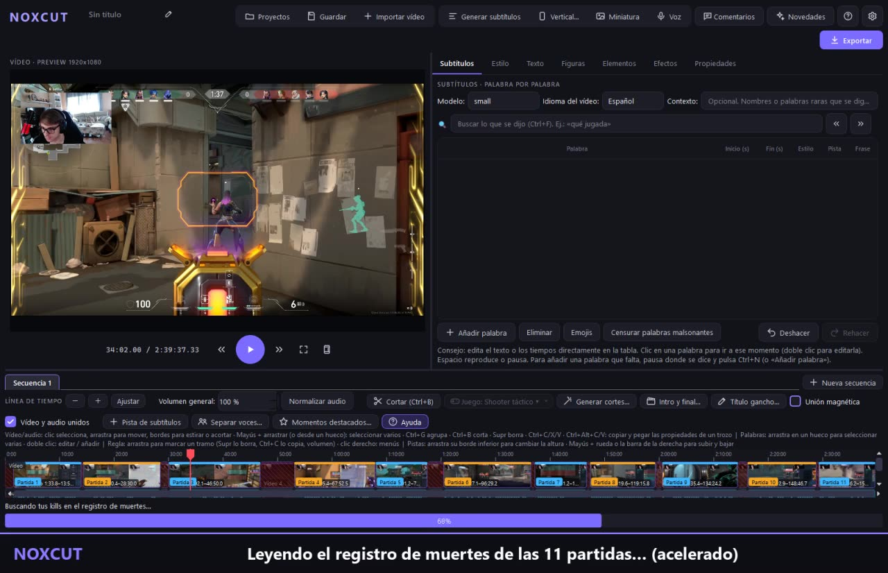](https://noxcut.es/#video-kills)

Sin escribir nada: NoxCut reconoce al jugador por sus propias muertes, cuenta las kills de cada ronda y se queda con las que elijas (dobles, triples, ace…). Antes de cambiar nada, dice lo que va a hacer.

### [Tus proyectos al abrir](https://noxcut.es/#video-proyectos) (0:23)

[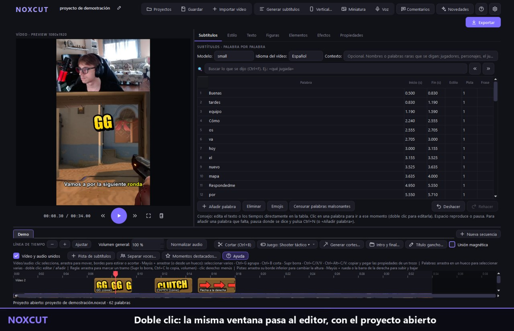](https://noxcut.es/#video-proyectos)

Una sola ventana: NoxCut se abre con todos tus proyectos, cada uno con un fotograma de su vídeo. Se buscan mientras escribes y, al elegir uno, la misma ventana pasa al editor.

### [Elementos: arrastrar y buscar](https://noxcut.es/#video-elementos) (0:17)

[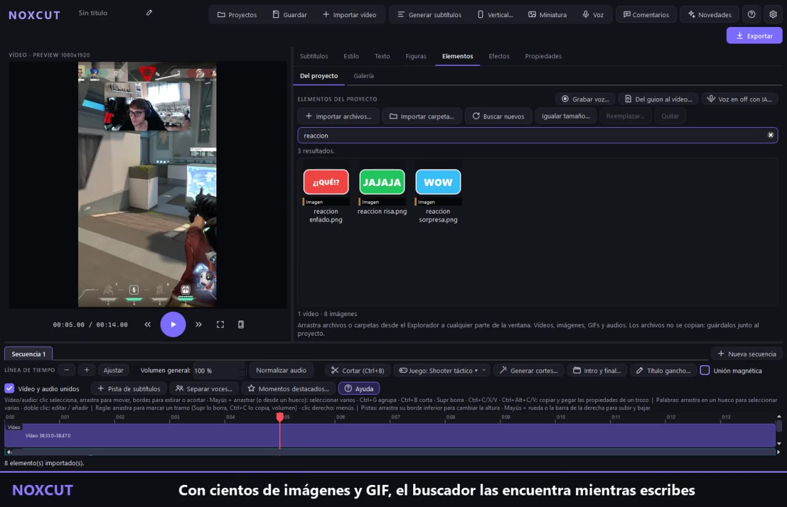](https://noxcut.es/#video-elementos)

Imágenes y GIF arrastrados desde el Explorador o el Finder a cualquier parte de la ventana. Con cientos, el buscador los encuentra mientras escribes; luego, al vídeo.

### [La guía: cada parte, explicada en su sitio](https://noxcut.es/#video-guia) (0:27)

[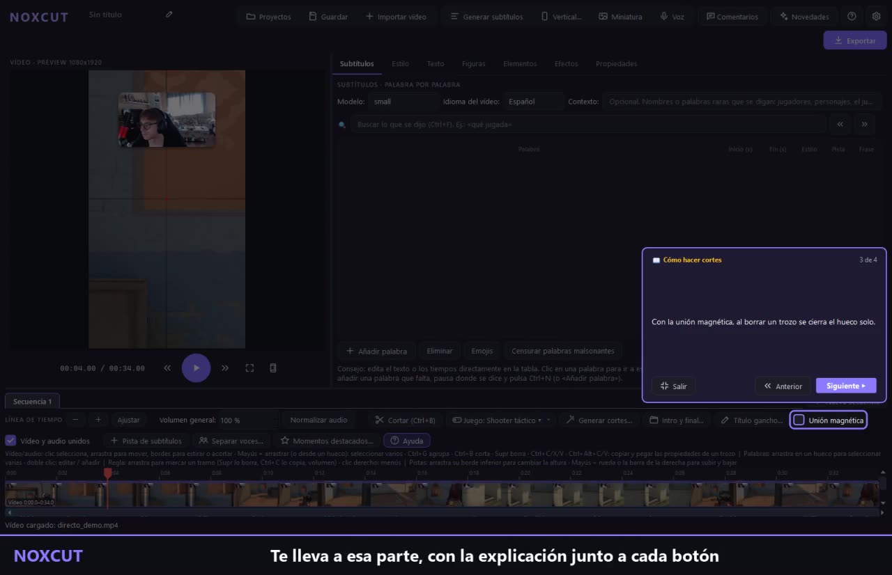](https://noxcut.es/#video-guia)

«📖 Guía»: elige un tema (por ejemplo, «Cómo hacer cortes») y NoxCut te lleva a esa parte, con una explicación junto a cada botón. O el recorrido completo, que se para y se sigue cuando quieras.

### [Seleccionar, borrar y agrupar trozos](https://noxcut.es/#video-seleccion) (0:25)

[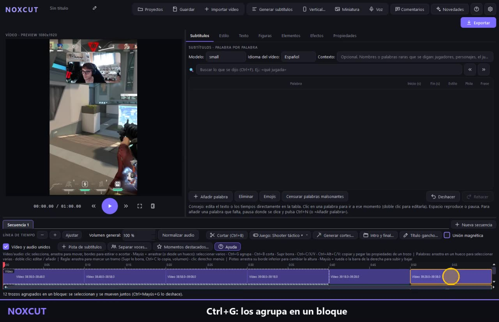](https://noxcut.es/#video-seleccion)

Como en cualquier editor: arrastrar para seleccionar varios trozos, Mayús + clic, borrar un tramo de todas las pistas desde la regla y agrupar trozos en un bloque que se mueve entero.
