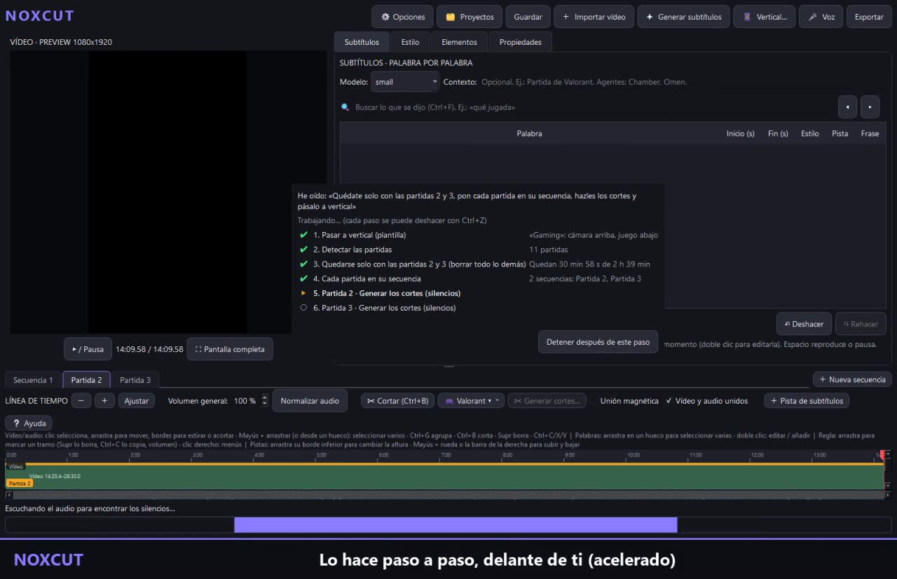
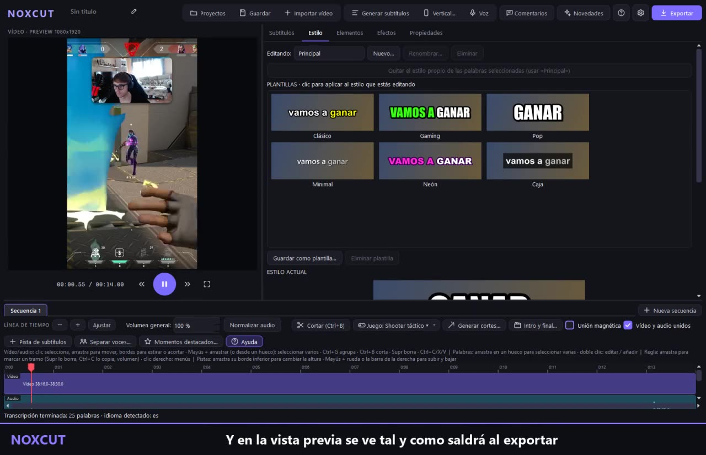
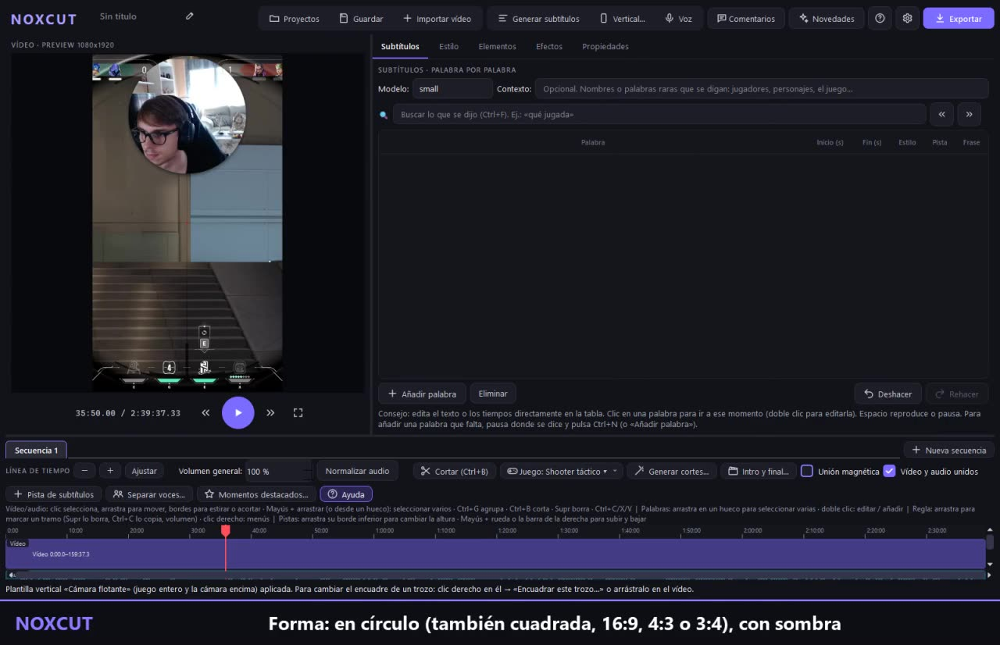
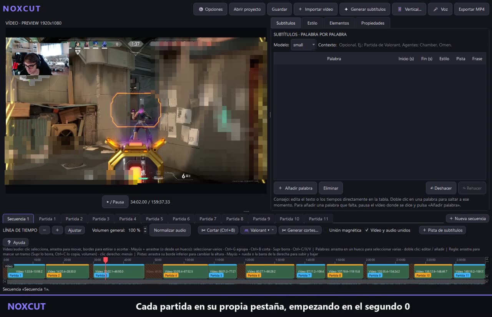
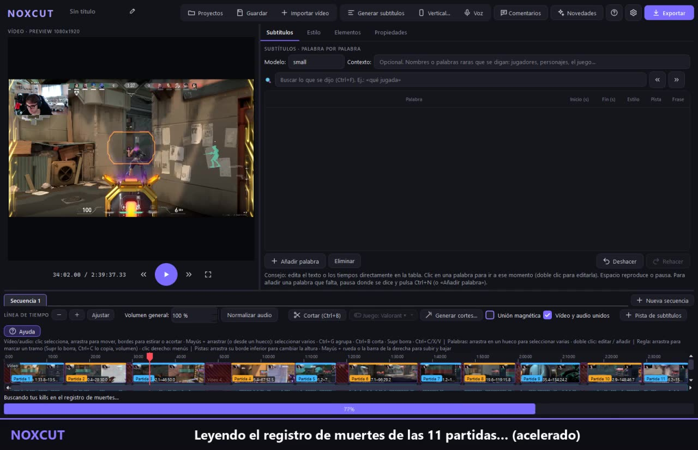
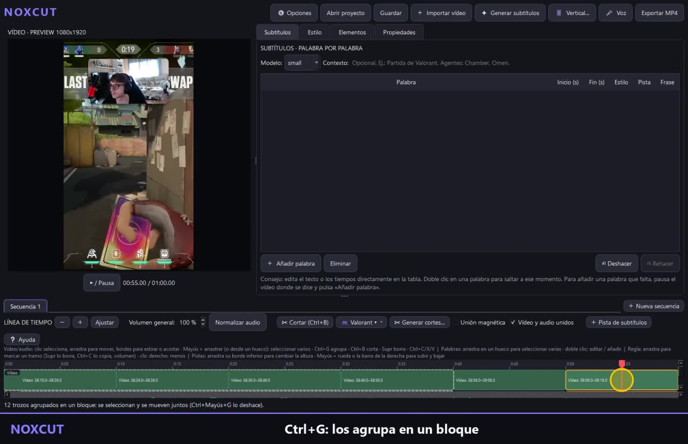

# Vídeos de NoxCut

GitHub no reproduce los vídeos aquí: pulsa una imagen para verlo en la página.
### [Editar con la voz](https://garzanox.github.io/noxcut/#video-voz) (0:26)

Se lo dices como a una persona: NoxCut enseña lo que ha entendido, paso a paso, y lo hace delante de ti.

### [Subtítulos palabra a palabra](https://garzanox.github.io/noxcut/#video-subtitulos) (0:30)

Se generan en tu ordenador (sin internet), cada palabra con su tiempo. Se corrigen escribiendo y el estilo se elige de una galería: karaoke, palabra a palabra o con «pop».

### [Plantilla vertical con la cámara flotante](https://garzanox.github.io/noxcut/#video-camara) (0:26)

El juego a pantalla completa y tu cámara encima, en círculo (o cuadrada, 4:3, 3:4…), con sombra. Se arrastra a cualquier sitio en la vista previa y la rueda del ratón cambia su tamaño.

### [Detectar partidas y una secuencia por partida](https://garzanox.github.io/noxcut/#video-partidas) (0:24)

Un directo de 2 h 40 min: NoxCut encuentra las 11 partidas y pasa cada una a su propia pestaña.

### [Recopilar tus kills](https://garzanox.github.io/noxcut/#video-kills) (0:41)

Sin escribir nada: NoxCut reconoce al jugador por sus propias muertes, cuenta las kills de cada ronda y se queda con las que elijas (dobles, triples, ace…). Antes de cambiar nada, dice lo que va a hacer.

### [Seleccionar, borrar y agrupar trozos](https://garzanox.github.io/noxcut/#video-seleccion) (0:25)

Como en cualquier editor: arrastrar para seleccionar varios trozos, Mayús + clic, borrar un tramo de todas las pistas desde la regla y agrupar trozos en un bloque que se mueve entero.
